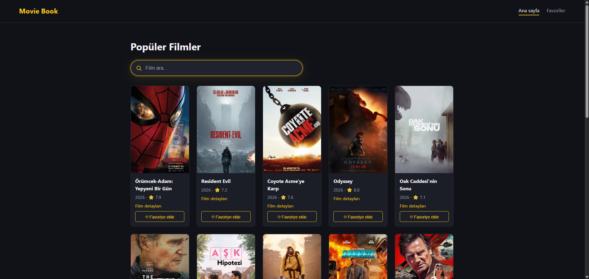

# Movie Book 🎬

TMDB API kullanan, React ile geliştirilmiş bir film rehberi uygulamasıdır. Popüler filmleri listeler, film aramaya izin verir, film detaylarını gösterir ve favori filmleri TMDB hesabında saklar.

**Canlı demo:** [https://movie-book-ky.vercel.app/]



Bu proje, temel React bilgisini (component yapısı, props, state, routing, API'den veri çekme) pekiştirmek amacıyla geliştirilmiş bir front-end çalışmasıdır. Veri TMDB API'sinden gelir. Token'ın tarayıcıya sızmaması için istekler küçük bir Vercel serverless fonksiyonundan geçer.

## Özellikler

- Popüler filmleri listeleme
- Film arama (debounce ile, her tuş vuruşunda istek atılmaz)
- Film detay sayfası: poster, özet, türler, süre, yıl ve puan
- Favorilere ekleme/çıkarma (TMDB hesabına kaydedilir, sayfa yenilense de kalır)
- Favoriler sayfası
- Yükleniyor, hata ve "film bulunamadı" durumları
- Posteri olmayan filmler için yedek görünüm
- Responsive, koyu temalı tasarım

## Kimlik Doğrulama ve İstek Akışı

- Tarayıcı TMDB'ye doğrudan istek atmaz, kendi adresindeki `/api/tmdb/...` yoluna atar.
- Bu isteği **sunucu tarafı** karşılar ve `Authorization: Bearer <token>` header'ını ekleyip TMDB'ye iletir. Favori isteklerine `session_id` de sunucuda eklenir.
  - Canlıda: `api/tmdb/[...path].js` (Vercel serverless fonksiyonu)
  - Yerelde (`npm run dev`): `vite.config.js` içindeki proxy ayarı
- Token ve session bilgisi tarayıcıya gönderilen koda girmez, tarayıcıdaki Network sekmesinde görünmez.
- Fonksiyon sadece uygulamanın kullandığı 5 isteğe izin verir (popüler filmler, arama, film detayı, favori listesi, favori ekle/çıkar) ve favori işlemlerini yalnızca tanımlı hesap için kabul eder.

## Favoriler

Favoriler TMDB'nin hesap endpoint'leriyle yönetilir:

- Liste: `GET /account/{account_id}/favorite/movies`
- Ekle / çıkar: `POST /account/{account_id}/favorite` (`favorite: true` veya `false`)

Favori butonuna basınca ekran hemen güncellenir, istek arka planda gider. İstek başarısız olursa değişiklik geri alınır ve hata gösterilir.

Not: Uygulamada kullanıcı girişi yoktur, favoriler tek bir TMDB hesabına bağlıdır. Aynı linki açan herkes aynı favori listesini görür.

## Kullanılan Teknolojiler

- React (Vite)
- React Router (`react-router-dom`)
- Context API
- TMDB API (v3)
- Vercel Serverless Functions
- CSS (Grid, Flexbox, CSS değişkenleri)
- ESLint

## Kurulum

Gereksinimler: Node.js (LTS veya üzeri) ve bir TMDB hesabı.

```bash
git clone https://github.com/Eminkrdmn/movie-book-ky.git
cd movie-book-ky
npm install
```

`.env.example` dosyasını `.env` olarak kopyala ve değerleri doldur:

```
TMDB_ACCESS_TOKEN=...
TMDB_SESSION_ID=...
VITE_TMDB_ACCOUNT_ID=...
VITE_TMDB_IMAGE_URL=https://image.tmdb.org/t/p/w500
```

`TMDB_ACCESS_TOKEN` ve `TMDB_SESSION_ID` gizlidir, başlarında `VITE_` yoktur. `VITE_` ile başlayan değişkenler tarayıcıya gömülür, bu yüzden sadece gizli olmayan değerlerde kullanılır.

Değerleri alma:

1. **Access token:** [TMDB API ayarları](https://www.themoviedb.org/settings/api) sayfasındaki **API Read Access Token**
2. **Session ID:** `GET /authentication/token/new` ile request token al, `https://www.themoviedb.org/authenticate/<REQUEST_TOKEN>` adresinde onayla, sonra `POST /authentication/session/new` ile `session_id` al
3. **Account ID:** `GET /account?session_id=<SESSION_ID>` cevabındaki `id`

Geliştirme sunucusunu başlat:

```bash
npm run dev
```

Uygulama `http://localhost:5173` adresinde açılır. `.env` dosyası `.gitignore`'a ekli olduğu için GitHub'a gitmez. `.env` veya `vite.config.js` değişince sunucuyu yeniden başlat.

### Vercel'de yayınlama

Project → Settings → Environment Variables altına `.env`'deki aynı değişkenleri ekle. `TMDB_ACCESS_TOKEN` ve `TMDB_SESSION_ID` **Secret**, `VITE_TMDB_ACCOUNT_ID` **Config** olarak eklenebilir. `vercel.json`, `/api` dışındaki adresleri ana sayfaya yönlendirir (SPA yönlendirmesi).

## Proje Yapısı

```
movie-book-ky/
├── api/
│   └── tmdb/
│       └── [...path].js
├── public/
├── src/
│   ├── components/
│   │   └── MovieCard.jsx
│   ├── context/
│   │   ├── favoritesContext.js
│   │   └── FavoritesProvider.jsx
│   ├── hooks/
│   │   └── useFavorites.js
│   ├── pages/
│   │   ├── Home.jsx
│   │   ├── Favorites.jsx
│   │   └── MovieDetails.jsx
│   ├── services/
│   │   └── movieApi.js
│   ├── App.jsx
│   ├── index.css
│   └── main.jsx
├── .env.example
├── vercel.json
├── vite.config.js
└── package.json
```

## Dosyaların Görevleri

- `main.jsx`: Uygulamayı başlatır, `BrowserRouter` ve `FavoritesProvider` ile sarar
- `App.jsx`: Menü ve sayfa rotalarını tanımlar
- `pages/Home.jsx`: Popüler filmler ve arama
- `pages/MovieDetails.jsx`: URL'deki `id`'ye göre tek filmin detayı
- `pages/Favorites.jsx`: TMDB hesabındaki favori filmler
- `components/MovieCard.jsx`: Tek bir film kartı
- `services/movieApi.js`: Tarayıcı tarafı istekler (`getPopularMovies`, `searchMovies`, `getMovieDetails`, `getFavorites`, `addFavorite`, `removeFavorite`)
- `api/tmdb/[...path].js`: Token'ı ekleyip istekleri TMDB'ye ileten sunucu fonksiyonu
- `vite.config.js`: Yerel geliştirmede aynı işi yapan proxy ayarı
- `context/FavoritesProvider.jsx`: Favori listesini bir kez çeker, tüm sayfalarla paylaşır
- `hooks/useFavorites.js`: Context'e erişim için kısayol hook

## Rotalar

| Yol          | Sayfa                               |
| ------------ | ----------------------------------- |
| `/`          | Ana sayfa (popüler filmler + arama) |
| `/movie/:id` | Film detayı                         |
| `/favorites` | Favoriler                           |

---

Bu ürün TMDB API'sini kullanır ancak TMDB tarafından onaylanmamıştır.
